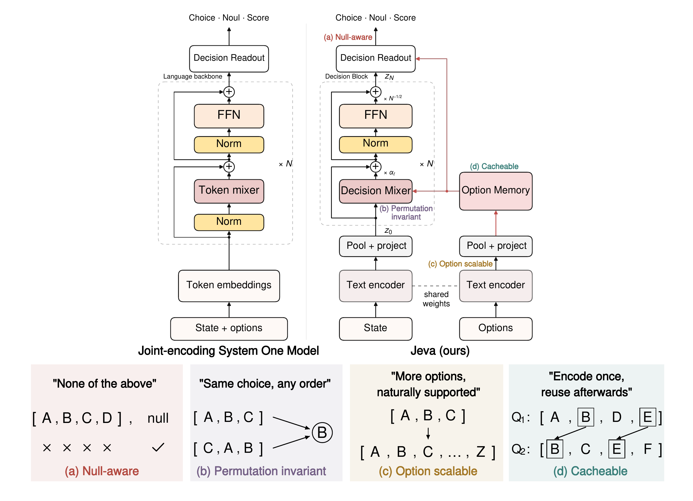
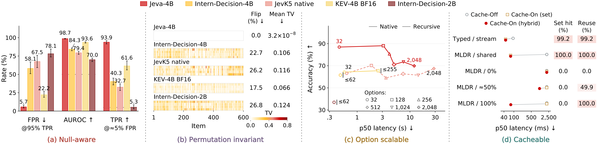

<div align="center">

# Jeva
### System One Models from First Principles

**Qi Li · Xinchao Wang**  
National University of Singapore

[Model](https://huggingface.co/LIQIIIII/Jeva-4B) · [Project page](https://liqiiiii.github.io/Jeva/) · [Evaluation](docs/evaluation.md) · [Fine-tuning](docs/finetuning.md)


</div>

<p align="center"><a href="site/assets/figure1.pdf"></a></p>

Jeva is a system one model with native design. Give it a state and typed
questions; get candidate probabilities, a Boolean probability, or an expected
rubric score. The language encoder represents the state and each option
independently. A compact decision stack updates only the state against the
complete option memory, so decisions remain set-dependent while option
computation is reusable.

- **Permutation symmetry:** reordering candidates permutes their probabilities,
  rather than changing their semantic identities.
- **Variable candidate sets:** shared scoring does not impose a fixed label
  vocabulary. Encoding runs in bounded batches; all options reach the head.
- **Null awareness:** an explicit coverage estimate separates answer availability
  from competition between available candidates.
- **Two-level reuse:** cache complete option tuples, or reuse individual option
  vectors and projected keys/values across newly assembled sets.

## Citation

```bibtex
@article{li2026jeva,
  title={Jeva: System One Models from First Principles},
  author={Li, Qi and Wang, Xinchao},
  journal={arXiv preprint arXiv:2610.18773},
  year={2026}
}
```

## Installation

Use Linux x86_64, an NVIDIA GPU, and a clean conda environment:

```bash
conda create -n jeva -c nvidia/label/cuda-12.8.1 python=3.12 cuda-nvcc=12.8.93 -y
conda activate jeva
git clone https://github.com/LiQiiiii/Jeva.git
cd Jeva
python -m pip install --upgrade pip
python -m pip install -r requirements.txt
jeva-doctor --check-kernels --strict
```

The requirements pair PyTorch 2.9.1 / CUDA 12.8 with matching accelerated kernels.
A compatible NVIDIA driver is required. The first request may compile kernels.
See [runtime configuration](docs/runtime.md) for memory limits and the slower
reference installation in `requirements-core.txt`.

## Local inference

```python
from jeva import Jeva, Choice, Noul, Score

model = Jeva.from_pretrained("LIQIIIII/Jeva-4B", device="cuda")

r = model.system_one(
    state=(
        "The production login page returns HTTP 503. "
        "All customers are unable to sign in or complete purchases."
    ),
    questions={
        "outage": Noul(
            instructions="Does this report an ongoing service outage?"
        ),
        "team": Choice(
            instructions="Which team should handle this support ticket?",
            criteria={
                "billing": "Payment disputes, invoices, and refunds.",
                "engineering": "Service outages, software errors, and broken features.",
                "general": "All other customer support requests.",
            },
            allow_null=False,
        ),
        "impact": Score(
            instructions="Rate the reported customer impact.",
            criteria=[
                "No customers are affected.",
                "Some customers are affected, but the service remains usable.",
                "All customers are blocked from using a core service.",
            ],
            values=[0, 1, 2],
        ),
    },
)

print("Outage probability:", r.answers["outage"].noul)
print("Assigned team:", r.answers["team"].choice)
print("Team probabilities:", r.answers["team"].probabilities)
print("Impact score (0–2):", r.answers["impact"].score)

```

| Interface | Result |
| :-- | :-- |
| `Choice` | A candidate key and its probability distribution |
| `Choice(..., allow_null=True)` | A candidate key or `None`, with explicit null probability |
| `Noul` | Probability that the statement is true, between 0 and 1 |
| `Score` | Expected rubric level; supplied `values` define custom numerical units |

For open-set Choice, candidate probabilities plus `null_probability` sum to one.
`conditional_probabilities` reports preference conditional on selecting a candidate.
Noul is a truth probability, not the null outcome. Exact ties use the first
candidate; open-set ties place null first.

Mappings format options as `label: description`; lists preserve their text.
For exact dataset option text and order, use `model.predict(...)`.
The [runnable example](examples/local_inference.py) returns all three output types.


### Cache and reuse

```python

policies = {
    "refund": (
        "Duplicate payments and refunds. When a customer reports being charged "
        "twice for the same purchase, first verify that both transactions have "
        "settled and refer to the same order. A pending authorization is not a "
        "second completed payment. If two settled charges are confirmed, refund "
        "the duplicate transaction to the original payment method and retain "
        "the valid payment. Record both transaction identifiers in the support "
        "case. Tell the customer that the refund normally appears within five "
        "to ten business days. This procedure does not cancel the order or "
        "change its delivery status."
    ),
    "cancellation": (
        "Order cancellation before dispatch. Customers may cancel an order "
        "while its fulfillment status is unshipped. Check the warehouse record "
        "before confirming cancellation. If the package has not been handed "
        "to the carrier, stop fulfillment, release reserved inventory, and "
        "refund the original payment. Send a cancellation confirmation after "
        "the warehouse acknowledges the request. If the package has already "
        "been dispatched, do not promise that shipment can be stopped; explain "
        "the return procedure instead. This policy concerns cancellation of "
        "the entire purchase, rather than correction of a duplicate charge."
    ),
    "delivery": (
        "Shipment tracking and delivery delays. For an order that has already "
        "been dispatched, retrieve the carrier name, tracking number, latest "
        "scan, and estimated delivery date. Explain the current shipment status "
        "without guaranteeing a delivery time not confirmed by the carrier. "
        "If tracking has not updated for three business days, open a carrier "
        "investigation and notify the customer when new information arrives. "
        "Check the delivery address if the carrier reports an address problem. "
        "Do not cancel a dispatched order through the warehouse cancellation "
        "process or issue a duplicate-payment refund."
    ),
    "account": (
        "Customer contact information and account updates. After verifying "
        "the customer's identity, support staff may update the email address "
        "or telephone number associated with an account. Confirm the new "
        "information and send an account-change notification. Never request "
        "a password or a full payment-card number in a support conversation. "
        "Changing account contact details does not automatically modify the "
        "delivery address of an existing order. For an order already in "
        "fulfillment, check its status and follow the relevant address-change "
        "procedure. This policy does not authorize refunds or cancellations."
    ),
}

model.cache = "hybrid"
model.clear_cache()

r1 = model.rank(
    state="I was charged twice for the same order. How can I get one charge refunded?",
    candidates=policies,
)

r2 = model.rank(
    state="My package has shipped, but tracking has not updated for four business days.",
    candidates=policies,
)

request = "Please cancel my order. The warehouse confirms it has not shipped."
subset = {key: policies[key] for key in ["refund", "cancellation", "account"]}

r3 = model.rank(state=request, candidates=subset)

model.cache = "none"
try:
    r3_off = model.rank(state=request, candidates=subset)
finally:
    model.cache = "hybrid"

print(
    f"\n{'Request':<25}"
    f"{'Top choice':<15}"
    f"{'Latency (ms)':>14}"
    f"{'Encoded tokens':>17}"
    f"{'Cached tokens':>16}"
)

for name, result in [
    ("1. Cold policy bank", r1),
    ("2. Same policy bank", r2),
    ("3. New candidate subset", r3),
    ("3. Same request, Off", r3_off),
]:
    print(
        f"{name:<25}"
        f"{result.ranking[0].label:<15}"
        f"{result.latency_ms:>14.1f}"
        f"{result.usage.encoded_option_tokens:>17}"
        f"{result.usage.cached_option_tokens:>16}"
    )

print(f"\nSame-request Off / reuse latency: {r3_off.latency_ms / r3.latency_ms:.2f}x")
```
With hybrid caching enabled, Jeva reuses option representations across changing requests and newly assembled candidate sets, while computing each decision anew.

`top_k` limits returned results, not the candidate pool. Keep the model instance
alive to reuse option computation across requests. Choose `cache="set"` for exact
ordered tuples, `cache="hybrid"` for additional individual-option reuse, or
`cache="none"` to disable caching. No previous answer is cached.

Caches have entry and tensor-byte limits. `usage.input_tokens` counts encoder
tokens actually processed; `requested_input_tokens` includes reused tokens.
`latency_ms` includes tokenization and synchronized execution, excluding model
loading. Over-limit inputs raise an error unless truncation is explicitly enabled.


### Offline loading

```bash
jeva-download LIQIIIII/Jeva-4B --local-dir ./models/Jeva-4B
```

```python
model = Jeva.from_pretrained("./models/Jeva-4B", local_files_only=True)
```

For access-controlled weights, authenticate first with `hf auth login` using an
authorized account. Pass `revision="<commit hash>"` to pin a Hub checkpoint.

## Evaluation

Run the model on a local JSONL file:

```bash
jeva-evaluate \
  --model ./models/Jeva-4B \
  --data ./my_eval.jsonl \
  --output ./results/my_eval
```

The [evaluation guide](docs/evaluation.md) covers input format, metrics,
permutations, cache comparisons, and resumable runs. 

<p align="center"><a href="site/assets/structural_properties.pdf"></a></p>

The manuscript reports 78.30% Typed Decisions accuracy, 98.66% null-detection
AUROC, and zero observed flips on 600 Choice items. Jeva handles 2,048 candidates
at 69.88% accuracy and 12.04 s median latency. Full option reuse across newly
assembled MLDR sets yields a 27.98× ratio of median request latencies, excluding
separately measured priming. These are paper measurements, not outputs of the
example code.

## Fine-tune on your own data

```bash
jeva-finetune \
  --model ./models/Jeva-4B \
  --train-data ./my_train.jsonl \
  --validation-data ./my_validation.jsonl \
  --output-dir ./runs/my-jeva \
  --mode head --device cuda \
  --epochs 3 --batch-size 1 --gradient-accumulation 8
```

`head` trains the decision module and projections while freezing the encoder.
`lora` also updates the existing adapter. Load the resulting directory with
`Jeva.from_pretrained()`.

See [fine-tuning](docs/finetuning.md) for the data schema, objectives, validation,
and resume. The small [JSONL example](examples/finetune_data.jsonl) illustrates
the format. Install `pip install -e '.[train]'`
only if you want to read your training data through the Hugging Face datasets API.

## Repository

```text
src/jeva/      local API, model runtime, evaluation, fine-tuning, installation checks
examples/      inference example and training-format illustration
train/         fine-tuning command wrapper
docs/          installation, evaluation, and fine-tuning guides
site/          project page, paper figures, and interactive diagrams
.github/       project-page deployment workflow
```


##  License
Code: [Apache-2.0](LICENSE). Model weights and datasets retain their respective
licenses.
